# Breath Runner

**A breathing-rehab game for people recovering from lung surgery at home. Inhale to jump, keep inhaling to glide across the cliffs.**

Designed, illustrated and built by **Jie (Fia) Yin**.

[](https://github.com/Lunarc-Seattle/breath-runner/actions/workflows/test-and-deploy.yml)
[](https://lunarc-seattle.github.io/breath-runner/quality/)
[](https://lunarc-seattle.github.io/breath-runner/quality/)
[](https://lunarc-seattle.github.io/breath-runner/quality/)

**[▶ Play it live](https://lunarc-seattle.github.io/breath-runner/)** · **[Quality report](https://lunarc-seattle.github.io/breath-runner/quality/)** · [Full design case study (PDF)](pic/Jie_Yin_Breath_Training.pdf)

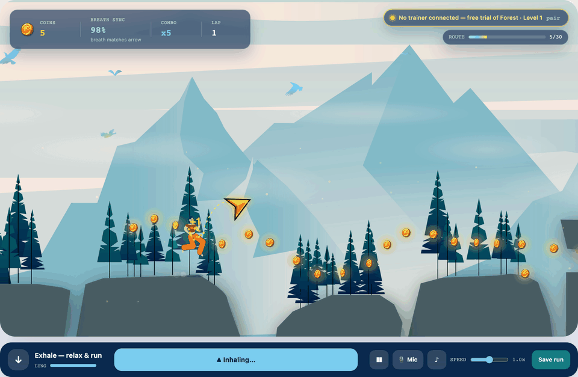

**Versions.** Every web release stays playable at its own URL, rebuilt from its git tag on each deploy (see [how](#engineering-highlights)):

| Version | What changed | Play | Source |
| --- | --- | --- | --- |
| v2 (current) | The web UI design: new Home, Progress, Trainer & care and Care team pages | [Play v2](https://lunarc-seattle.github.io/breath-runner/v2/) | [`web-v2`](https://github.com/Lunarc-Seattle/breath-runner/tree/web-v2) |
| v1 | The first release of the app and game | [Play v1](https://lunarc-seattle.github.io/breath-runner/v1/) | [`web-v1`](https://github.com/Lunarc-Seattle/breath-runner/tree/web-v1) |

---

## The problem

After thoracic surgery, patients are asked to do inspiratory breathing exercises every day with a plastic three-ball trainer. The exercise works, but it is repetitive and gives no sense of progress, so many people stop.

Breath Runner turns the same exercise into a short run through an illustrated landscape. The game rewards the breath the doctor wants: **long, steady inhales**, not short gasps.

## How it plays

- The runner moves on her own across the cliffs from the original illustration.
- When the golden arrow tilts up, **start inhaling**: she jumps. **Keep inhaling** and she glides. **Exhale** and she lands.
- A short breath can't clear the big gap in the middle; only a long, controlled inhale can. That's the core design decision: the hardest jump is the one that needs the most therapeutic breath.
- The lung meter empties while you glide and refills while you exhale, so you can't just hold forever.
- Falling never ends the run. She respawns on the last cliff, because this is rehab, not a test.

Input: hold the screen, hold Space, or **breathe into your microphone**. The mic mode listens for the sound of airflow, measures the room's noise first, and needs no hardware.

Each level trains a different breathing skill instead of just running faster. The start card explains it, and every number below is computed from the level data:

| Level | Skill | Breaths per lap | Avg inhale | Breath refill | Coin reach | Pace |
|---|---|---|---|---|---|---|
| Forest · 1 | Learn the jump: only the big gap needs a real breath | 4 | 0.43 s | 1.2 s fast | 58 px generous | 1.0× |
| Sunlit Canyon · 2 | Keep a rhythm: short hops between the big jumps | 7 | 0.64 s | 2.2 s | 42 px | 1.1× |
| Glacier Ridge · 3 | Long, controlled breaths: coins only at the arc top, slow refill | 4 | 1.23 s | 2.8 s slow | 28 px precise | 1.2× |

The difficulty gap is intentional: Level 1 refills breath in 1.2 s and has a 58 px pickup radius so beginners can experiment freely; Level 3 needs a full exhale before the next breath (2.8 s) and demands precise timing to hit the 28 px coin window at the arc peak.

A test proves the Glacier point: cutting each breath to 0.6 s at the same jump points collects fewer than half the coins.

Each level, played by following its breath cues (one clean lap each, recorded frame by frame with [`scripts/media/`](scripts/media/record-gameplay.mjs)):

| | Take-off | Glide | Lap complete |
|---|---|---|---|
| **Forest · 1** | 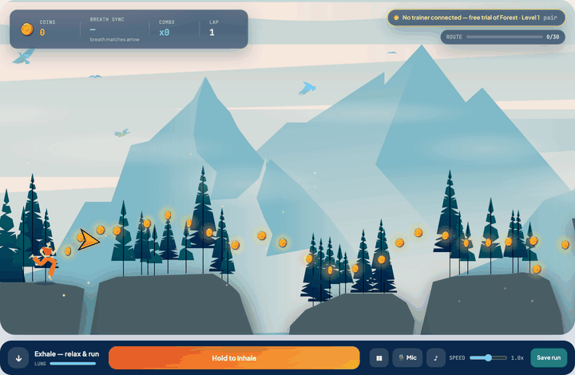 |  | 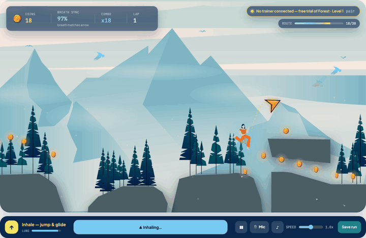 |
| **Sunlit Canyon · 2** | 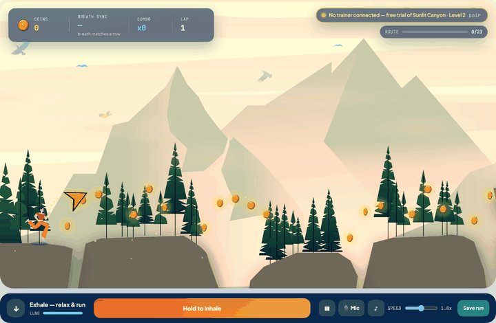 | 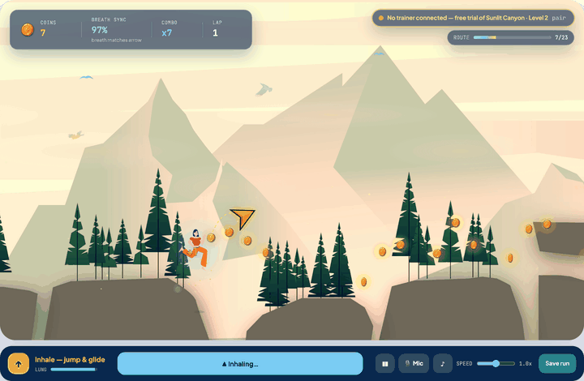 | 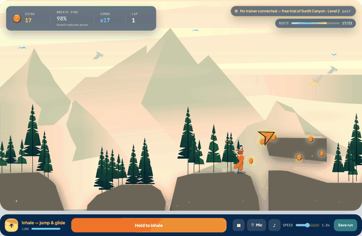 |
| **Glacier Ridge · 3** | 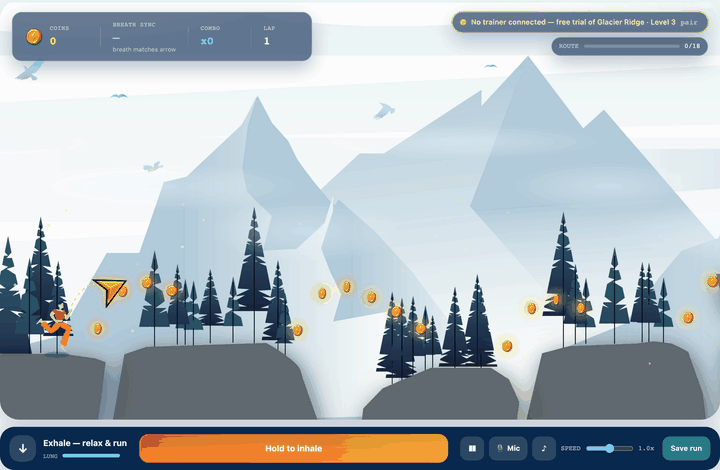 | 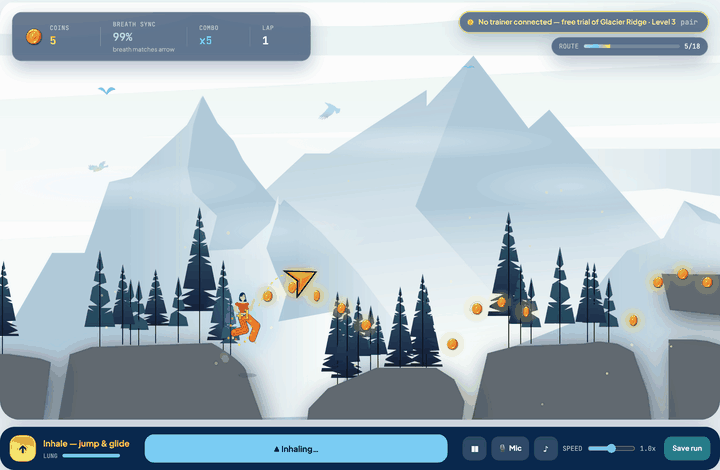 | 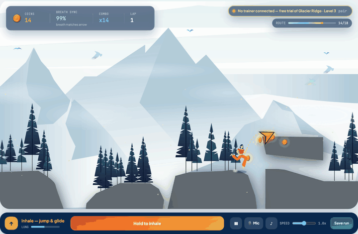 |

## From sketch to playable game

I designed the whole product, not just the screens: the physical trainer, the companion app, the illustration, and now the game running in the browser.

| 1 · Form sketches | 2 · Trainer device (3D) |
|---|---|
| 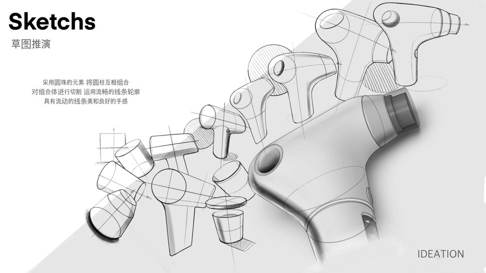 | 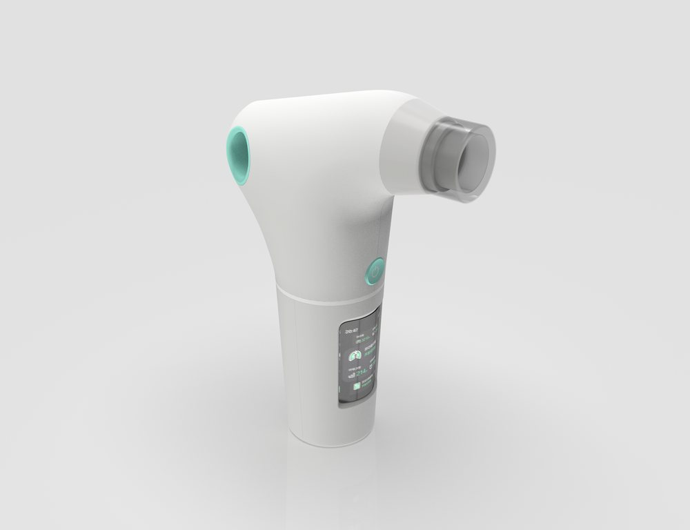 |

| 3 · Companion app design | 4 · Level illustration (Illustrator) |
|---|---|
| 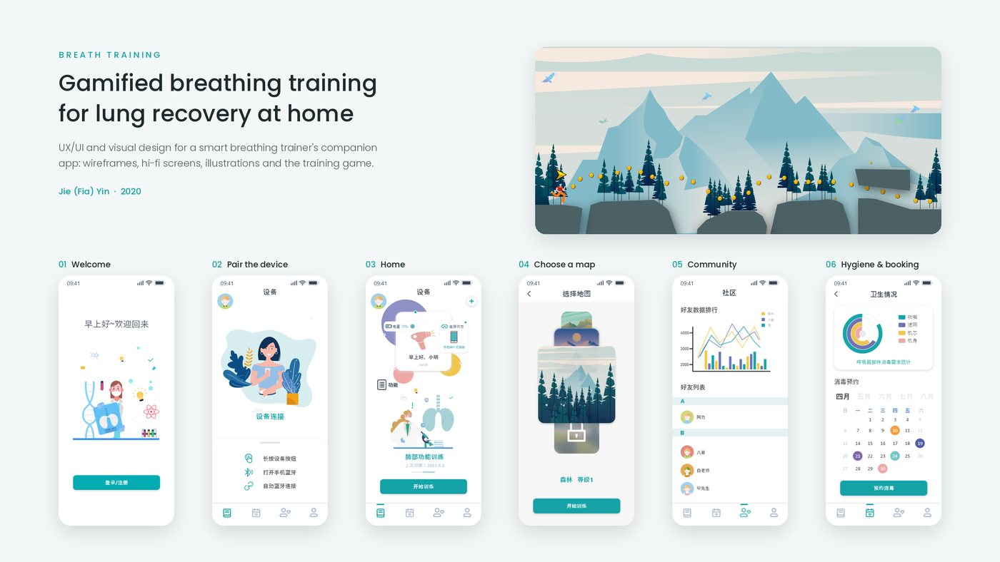 |  |

The game runs on the original `pic/background.ai` file, not on a redrawing of it. An export script reads the Illustrator file, renders the scenery without the sprites, pulls out the runner, arrow and coin artwork, and traces the vector cliff shapes into collision data. Change the illustration, re-run the script, and the level changes with it.

## Engineering highlights

- **Art pipeline from the source file.** `scripts/assets/export_forest_ai.py` uses PyMuPDF to read the `.ai`. It deletes the sprite images before rendering the background, samples the cliff paths into top-surface profiles, and writes the coin, runner and arrow positions to `src/animation/forestMap.js`. `scripts/assets/cut_runner_torso.py` then cuts the legs off the runner sprite, and the engine draws bending legs under her hips: a run cycle, knees tucked on the jump, and a crouch on landing.
- **Game logic separated from rendering.** `src/core/forestRunner.ts` is a pure, typed step function covering jump, glide, lung, coins, falls and laps, all in the illustration's own coordinates. `src/animation/forestEngine.js` only draws what the state says (type-checked through JSDoc against the core types), so the rules can be unit-tested without a browser.
- **Levels that are guaranteed to be beatable.** Levels 2 and 3 are written as *breath scripts* (where to inhale, for how long). The physics simulates each script and drops coins along the flight arcs, so every coin is reachable by construction. A test plays each script and checks that it collects every coin with zero falls.
- **Microphone breath detection.** `src/lib/micBreath.js` band-passes the mic signal, calibrates to the room's noise floor, and uses hysteresis so a fading breath doesn't flicker. The detector is a pure function with its own tests.
- **Typed core, small React shell.** Vite + React 18. The game rules, levels, session model and stats in `src/core/` are TypeScript with domain types (`RunnerState`, a discriminated `RunnerEvent` union, `ForestMap`, `Session`). Node 24 runs the same `.ts` files directly for the server and tests, so the browser and the API share one validator.
- **Versioned releases you can still play.** Work happens on feature branches and lands on `main` through pull requests that must pass lint, type checks, unit tests, Playwright and Lighthouse. Every merge to `main` deploys automatically. Each web release is an annotated git tag (`web-v1`, `web-v2`, …), and the deploy ([`scripts/ci/build-versions.sh`](scripts/ci/build-versions.sh)) rebuilds every tag at its own URL (`/v1/`, `/v2/`, …) with an "archived version" banner. Because of the relative base and hash routing, an old build works unchanged in a subfolder. The app's header names the version you're on and links to the others.
- **One codebase, two storage backends.** On GitHub Pages, runs are saved in `localStorage`. Under `npm start`, they go through an Express REST API documented in [`docs/openapi.yaml`](docs/openapi.yaml) and served at `/api/v1/openapi.yaml`. The client probes for the API and falls back on its own.
- **A production-shaped API.**
  - **Validation:** the server generates ids and rejects impossible results (coins above what a run allows, future timestamps), returning 400s with reasons, 413 for oversized bodies and 429 from the write rate limit.
  - **Paging:** cursor pagination is stable even when timestamps tie.
  - **Hardening:** helmet security headers with a strict CSP, structured pino request logs that never contain bodies, and a health check that verifies storage is writable.
  - **Shutdown:** on SIGTERM the server drains in-flight writes before exiting.
  - **Storage:** the default JSON store skips corrupt rows on load and rolls back failed writes, so memory and disk stay consistent even when writes interleave. Set `USE_SQLITE=1` (or a `.db` `DATA_FILE`) to use SQLite instead ([`server/models/sqliteRepository.js`](server/models/sqliteRepository.js)): WAL mode, an index that serves the paged query, and a one-time migration that imports an existing JSON file in a single transaction.
- **Real-time co-op.** A WebSocket server shares the API's port (`/ws/coop`) and pairs two players per room, relaying each player's breath about 10 times a second. The `useCoopRoom` hook tracks the connection as a typed state machine. On GitHub Pages, where there is no server, the Co-op page says so instead of timing out.
- **Routing and resilience.** Hash routes (`#/play`, `#/history`) make deep links, reload and the back button work on static hosting. Each page sits in its own error boundary.
- **Tested at three levels.** 106 unit and API tests (`node:test`, about 93% line coverage, gated at 85% in CI) and 59 Playwright end-to-end tests. One plays a full lap by following the on-screen breath cue, saves it, and checks it on the Progress page. Others cover every route, keyboard and focus behaviour, and API validation.
- **TypeScript migration.** `App.tsx`, `HomePage.tsx`, `HistoryPage.tsx`, `useCountUp.ts` and `seedData.ts` are now strict TypeScript. Declaration files (`AppContext.d.ts`, `RidgeChart.d.ts`) type the JS modules they wrap without converting their entire codebase. ESLint was extended to enforce TypeScript rules across all `.ts` and `.tsx` files.
- **Physics off the main thread.** `src/core/physicsWorker.ts` runs `stepRunner()` in a Web Worker. The engine uses a double-buffer: the Worker computes frame N while the main thread renders frame N−1, keeping physics and rendering fully parallel. The Worker pre-loads level geometry on `setMap()` so only the compact `RunnerState` crosses the thread boundary at 60 fps. If the Worker is unavailable (old browser, strict CSP), the engine falls back to synchronous physics transparently.
- **Route-level code splitting.** All 13 pages use `React.lazy()` + `Suspense`. The initial bundle dropped from **293 KB → 168 KB (−43%)** gzipped; each page loads only when first visited.
- **CI that gates the deploy, with a public report.** Each push and PR runs these in parallel:
  - lint (ESLint), formatting (Prettier) and type checking;
  - unit tests with coverage, and the production build;
  - the e2e suite;
  - Lighthouse CI, which fails the build if any of the three key pages drops below 100 accessibility.

  A report job turns the results into a summary on every PR and, on `main`, into the public [quality report](https://lunarc-seattle.github.io/breath-runner/quality/). The report shows every e2e test by name, coverage per file and the full Lighthouse reports, and it feeds the badges above. `main` is protected: changes land only through pull requests with passing checks, and only `main` deploys. Dependencies are updated by hand on their own branch, and major versions one at a time.
- **A design system in code.** The palette lives in one token file ([`src/styles/tokens.js`](src/styles/tokens.js)) that feeds Tailwind and the JS helpers. Each token documents its role and contrast rule (e.g. white text only on the "deep" variants). Moving 220 hard-coded colors to tokens was verified to change nothing: computed styles matched across 2,325 elements on all 13 pages.
- **No third-party requests at runtime.** Fonts are self-hosted and React is bundled, so the static build ships a CSP of `default-src 'self'`.
- **Accessible and fast.** Lighthouse (desktop, checked in CI) scores **100 for Accessibility, Best Practices and SEO** on the home, game and history pages, with Performance 98–100. Filled brand colors use slightly deeper variants wherever they carry white text, so every label meets WCAG AA contrast (4.5:1). The game has an `aria-live` breath cue, labelled controls, focus moved to each card's main action, and reduced-motion support. The navigation drawer is `inert` while closed.

## What's new since v2

Live on the main site now. It will be tagged and archived as **v3** once the last game change lands.

**The game**
- **Fairer jumps and landings.** An inhale up to 0.2 s after walking off a cliff edge still jumps, which also covers slow breath onsets and the mic's delay. Falls are quicker when you exhale; gliding is unchanged.
- **A 3-2-1 count-in** before every run, lap and resume, paced like a breath and asking you to breathe out first.
- **Breath sync that means what it says.** It no longer reads 0% at the start, and the arrow's lead-in before each jump counts as in sync, so a clean lap now scores 97–99%.
- **A runner with real legs.** The legs are drawn in code under the sprite, so she strides, tucks on the jump and crouches on landing.
- **Personal best and difficulty dots** on the lap card and level picker.

**The app**
- **One design across every page.** Schedule, Choose a map, My profile and Friends ranking now use the same cards, type and colors as Home and Progress.
- **Home:** a Today / This week toggle for breath sync, a day streak and a weekly goal of three sessions.
- **Progress:** five achievements computed from your runs, a today-vs-week overview and a "Download chart" PNG export.
- **A first visit isn't empty.** Ten demo runs are seeded locally on first load, and pages without data show what will appear there.
- **Installable** as a PWA, and laid out for phones down to 320 px.

**Under the hood**
- **SQLite storage** and **real-time two-player co-op over WebSockets** on the server (details under [Engineering highlights](#engineering-highlights)).
- **Physics in a Web Worker**, **route-level code splitting** (initial bundle −43%) and more of the app in strict TypeScript.

## The rest of the app

Breath Runner is page 04 of a companion-app prototype: home, daily schedule, map choice, spirometry lab, co-op mode, leaderboard, trainer & care (hygiene booking and device loan), a care team view, physician guidance, recovery journey and profile. **Home** and **Progress** are driven by your saved runs: today's three sessions, breath sync over the last week, a ridge chart of each day's best breath sync, and a table of runs with coins, falls and laps. Everything else (friends, the trainer loan, hygiene, the care team's patients) is sample data and says so on the page. Navigation hides in a drawer that eases in when you hover the page pill or the left edge of the screen; the Breath Runner mark is always Home.

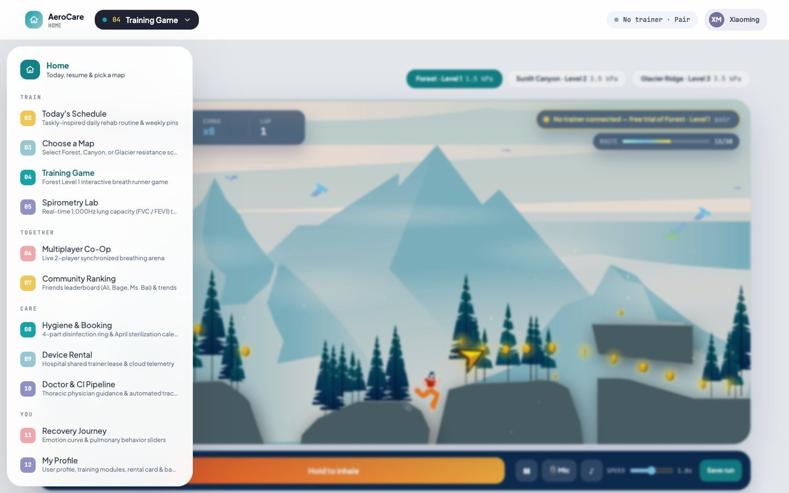

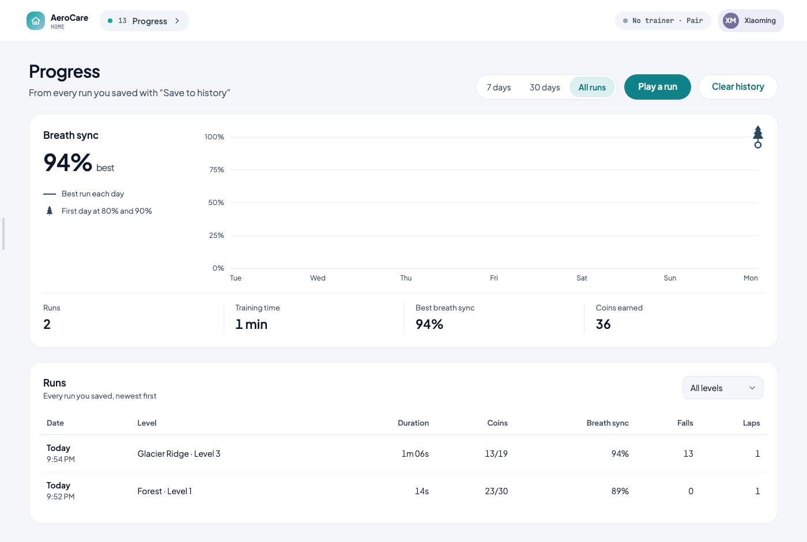

**Honest scope:** apart from the game, these pages are interactive prototypes with sample data. Trainer pairing uses the real Web Bluetooth API (Chrome / Edge) and looks for a device named `AeroCare…`. The trainer itself is a design concept, so without one the app says no trainer was found and points you to free-trial mode. The microphone input, the game and the session storage are real.

## Run it locally

Requires Node 24+.

```bash
npm install
npm start             # build, then serve app + API at http://localhost:4000
npm run dev           # Vite dev server with hot reload (run `npm run server` alongside for the API)
```

| Command | What it does |
|---|---|
| `npm test` | 106 unit and API tests (`npm run test:coverage` adds the coverage gate) |
| `npm run test:e2e` | 59 Playwright end-to-end tests (builds and starts the server itself) |
| `npm run lint` · `npm run typecheck` · `npm run format:check` | the same checks CI runs |
| `npm run check` | lint, format, types and unit tests with coverage in one go |

Server settings (environment variables): `PORT` (default 4000), `DATA_FILE` (session file; a `.db` path uses SQLite), `USE_SQLITE` (`1` for SQLite), `LOG_LEVEL` (pino level, default `info`), `RATE_LIMIT_PER_MIN` (writes per client per minute, default 30), `TRUST_PROXY` (set when running behind a reverse proxy).

To re-export the level art after editing the illustration:

```bash
python3 -m pip install -r scripts/assets/requirements.txt
python3 scripts/assets/export_forest_ai.py
python3 scripts/assets/cut_runner_torso.py
```

## Project map

```
pic/background.ai               original illustration (source of truth for the level)
scripts/assets/                 .ai -> web assets + cliff/coin data
public/assets/forest/           exported background and sprites
public/manifest.webmanifest     PWA manifest (installable on desktop/mobile)
src/core/                       typed game rules, levels, session model, stats (pure, tested)
src/core/physicsWorker.ts       Web Worker — runs stepRunner() off the main thread
src/styles/tokens.js            design tokens: the brand palette and its contrast rules
src/animation/forestEngine.js   canvas renderer, camera, particles (uses Worker for physics)
src/app/                        routes, hash router, app state (useApp), useCountUp hook
src/pages/                      one .tsx component per route, loaded lazily
src/components/                 game stage, navigation drawer, error boundary
src/lib/micBreath.js            microphone breath detector
src/data/seedData.ts            demo history seeded into localStorage on first load
server/                         Express API and JSON session store
config/csp.js                   one Content-Security-Policy for the server header and the static build
docs/openapi.yaml               API specification
tests/                          node:test suites; tests/e2e/ Playwright specs
```

## License

© 2020–2026 Jie (Fia) Yin. **All rights reserved.** This repository is public so the work can be viewed and evaluated. The code, illustrations, 3D models, sketches and design documents may not be copied, reused or redistributed without written permission. See [LICENSE](LICENSE).
