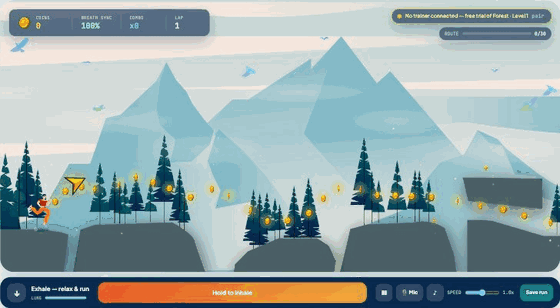
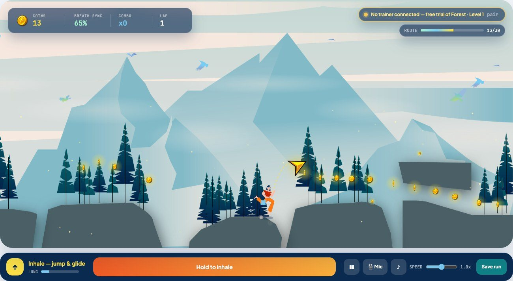
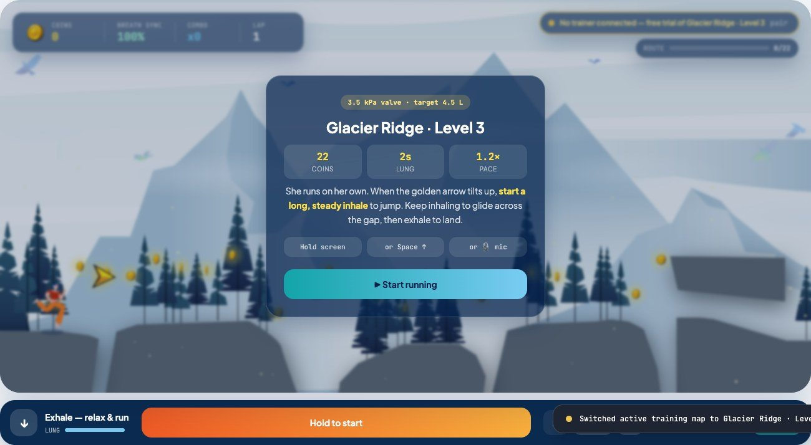

# Breath Runner

**A breathing-rehab game for people recovering from lung surgery at home. Inhale to jump, keep inhaling to glide across the cliffs.**

Designed, illustrated and built by **Jie (Fia) Yin**.

[](https://github.com/Lunarc-Seattle/breath-runner/actions/workflows/test-and-deploy.yml)

**[▶ Play it live](https://lunarc-seattle.github.io/breath-runner/)** · [Full design case study (PDF)](pic/Jie_Yin_Breath_Training.pdf)



---

## The problem

After thoracic surgery, patients are asked to do inspiratory breathing exercises every day with a plastic three-ball trainer. The exercise works, but it is repetitive and gives no sense of progress, so many people stop.

Breath Runner turns the same exercise into a short run through an illustrated landscape. The game rewards the breath the doctor wants: **long, steady inhales**, not short gasps.

## How it plays

- The runner moves on her own across the cliffs from the original illustration.
- When the golden arrow tilts up, **start inhaling**: she jumps. **Keep inhaling** and she glides. **Exhale** and she lands.
- A short breath can't clear the big gap in the middle; only a long, controlled inhale can. That's the core design decision: the hardest jump is the one that needs the most therapeutic breath.
- The lung meter empties while you glide and refills while you exhale, so you can't just hold forever.
- Falling never ends the run. She respawns on the last cliff, because this is rehab, not a test.

Input: hold the screen, hold Space, or **breathe into your microphone**. The mic mode listens for the sound of airflow, measures the room's noise first, and needs no hardware.

| Level | Coins | Breaths per lap | Lung (glide time) | Pace |
|---|---|---|---|---|
| Forest · 1 | 30, placed as drawn in the illustration | ~5, only at the gaps | 2.4 s | 1.0× |
| Sunlit Canyon · 2 | 22, along longer glide arcs | 7 | 2.2 s | 1.1× |
| Glacier Ridge · 3 | 22, higher and sparser | 10 | 2.0 s | 1.2× |

<p>
  
  
</p>

## From sketch to playable game

I designed the whole product, not just the screens: the physical trainer, the companion app, the illustration, and now the game running in the browser.

| 1 · Form sketches | 2 · Trainer device (3D) |
|---|---|
|  |  |

| 3 · Companion app design | 4 · Level illustration (Illustrator) |
|---|---|
|  |  |

The game runs on the original `pic/background.ai` file, not on a redrawing of it. An export script reads the Illustrator file, renders the scenery without the sprites, pulls out the runner, arrow and coin artwork, and traces the vector cliff shapes into collision data. Change the illustration, re-run the script, and the level changes with it.

## Engineering highlights

- **Art pipeline from the source file.** `scripts/assets/export_forest_ai.py` uses PyMuPDF to read the `.ai`. It deletes the sprite images before rendering the background, samples the cliff paths into top-surface profiles, and writes the coin, runner and arrow positions to `src/animation/forestMap.js`.
- **Game logic separated from rendering.** `src/core/forestRunner.ts` is a pure, typed step function covering jump, glide, lung, coins, falls and laps, all in the illustration's own coordinates. `src/animation/forestEngine.js` only draws what the state says, so the rules can be unit-tested without a browser.
- **Levels that are guaranteed to be beatable.** Levels 2 and 3 are written as *breath scripts* (where to inhale, for how long). The physics simulates each script and drops coins along the flight arcs, so every coin is reachable by construction. A test plays each script and checks that it collects every coin with zero falls.
- **Microphone breath detection.** `src/lib/micBreath.js` band-passes the mic signal, calibrates to the room's noise floor, and uses hysteresis so a fading breath doesn't flicker. The detector is a pure function with its own tests.
- **Typed core, small React shell.** Vite + React 18. The game rules, levels, session model and stats in `src/core/` are TypeScript with domain types (`RunnerState`, a discriminated `RunnerEvent` union, `ForestMap`, `Session`). Node 24 runs the same `.ts` files directly for the server and tests, so the browser and the API share one validator.
- **One codebase, two storage backends.** On GitHub Pages, runs are saved in `localStorage`; under `npm start`, they go through an Express REST API (`/api/v1/sessions`). The client probes for the API and falls back on its own. The server generates ids, rejects impossible results (coins above what a run allows, future timestamps), returns 413 for oversized bodies, and its JSON store rolls back failed writes so memory and disk never disagree.
- **Routing and resilience.** Hash routes (`#/play`, `#/history`) make deep links, reload and the back button work on static hosting. Each page sits in its own error boundary.
- **Tested at three levels.** 39 unit and API tests (`node:test`, 93% line coverage with a CI gate), and 34 Playwright end-to-end tests. One plays a full lap by following the on-screen breath cue, saves it, and checks it in Run History. Others cover every route, keyboard and focus behaviour, and API validation.
- **CI that gates the deploy.** Each push and PR runs lint (ESLint), formatting (Prettier), type checking, unit tests with coverage, the production build and the e2e suite. Only `main` deploys, and only when all of it passes. Dependabot keeps dependencies current.
- **Accessible and fast.** Lighthouse (desktop) scores **100 for Accessibility, Best Practices and SEO** on the home, game and history pages, with Performance 97–99. Filled brand colors use slightly deeper variants wherever they carry white text, so every label meets WCAG AA contrast (4.5:1). The game has an `aria-live` breath cue, labelled controls, focus moved to each card's main action, and reduced-motion support. The navigation drawer is `inert` while closed.

## The rest of the app

Breath Runner is page 04 of a 12-page companion-app prototype: welcome & resume, daily schedule, map choice, spirometry lab, co-op mode, leaderboard, hygiene booking, device rental, physician guidance, recovery journey and profile. A 13th page, **Run History**, lists your saved runs with coins, breath sync, falls and laps. Navigation hides in a drawer that eases in when you hover the page pill or the left edge of the screen; the AeroCare mark is always Home.


**Honest scope:** apart from the game, these pages are interactive prototypes with sample data. Trainer pairing uses the real Web Bluetooth API (Chrome / Edge) and looks for a device named `AeroCare…`. The trainer itself is a design concept, so without one the app says no trainer was found and points you to free-trial mode. The microphone input, the game and the session storage are real.

## Run it locally

Requires Node 24+.

```bash
npm install
npm start             # build, then serve app + API at http://localhost:4000
npm run dev           # Vite dev server with hot reload (run `npm run server` alongside for the API)
```

| Command | What it does |
|---|---|
| `npm test` | 39 unit and API tests (`npm run test:coverage` adds the coverage gate) |
| `npm run test:e2e` | 34 Playwright end-to-end tests (builds and starts the server itself) |
| `npm run lint` · `npm run typecheck` · `npm run format:check` | the same checks CI runs |
| `npm run check` | lint, format, types and unit tests with coverage in one go |

To re-export the level art after editing the illustration:

```bash
python3 -m pip install -r scripts/assets/requirements.txt
python3 scripts/assets/export_forest_ai.py
```

## Project map

```
pic/background.ai               original illustration (source of truth for the level)
scripts/assets/                 .ai -> web assets + cliff/coin data
public/assets/forest/           exported background and sprites
src/core/                       typed game rules, levels, session model, stats (pure, tested)
src/animation/forestEngine.js   canvas renderer, camera, particles
src/app/                        routes, hash router, app state (useApp)
src/pages/                      one component per route
src/components/                 game stage, navigation drawer, error boundary
src/lib/micBreath.js            microphone breath detector
server/                         Express API and JSON session store
tests/                          node:test suites; tests/e2e/ Playwright specs
```

## License

© 2020–2026 Jie (Fia) Yin. **All rights reserved.** This repository is public so the work can be viewed and evaluated. The code, illustrations, 3D models, sketches and design documents may not be copied, reused or redistributed without written permission. See [LICENSE](LICENSE).
